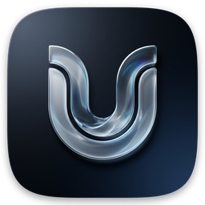

<div align="center">
  
  <h1>URTK Flow</h1>
  <p>Расписание пар, звонки, консультации преподавателей и навигатор материалов УРТК им. А.С. Попова в едином настольном и веб-клиенте.</p>
  <p>
    <a href="https://flow.mdsdev.ru/">Сайт продукта</a> ·
    <a href="https://flow.mdsdev.ru/app/">Веб-версия / PWA</a> ·
    <a href="https://mdsdev.ru/">mdsdev</a>
  </p>
</div>

---

## Возможности

- **Расписание групп (`Академикс`)** — актуальное расписание на неделю и по дням для всех очных групп 1–4 курсов с офлайн-кэшем в SQLite, индикацией текущей и следующей пары и таймером звонков реального учебного дня группы.
- **Консультации преподавателей** — автоматический разбор графика консультаций, фильтрация преподавателей выбранной группы, закрепление нужных преподавателей вверху списка и быстрый переход к консультации прямо из карточки пары.
- **Навигатор дистанта и материалов** — прямые ссылки на папку конкретной учебной группы на Google Диске, Moodle и официальные ресурсы колледжа.
- **Виджет рабочего стола Windows** — компактное окно в стиле Liquid Glass поверх обоев рабочего стола (устойчивое к `Win + D` и сворачиванию всех окон), настраиваемые масштаб и прозрачность, сворачивание основного окна в системный трей.
- **Фоновая синхронизация и уведомления** — автоматическое обновление по интервалу (`15 / 30 / 60 мин`), уведомления об изменениях в расписании и утренняя сводка пар.
- **Мобильная PWA (`iOS / Android`)** — веб-приложение с поддержкой установки на экран «Домой», серверным singleflight-кэшем и автономным режимом через Service Worker.

## Архитектура и безопасность

- **Стек настольного клиента:** `Rust`, `Tauri v2`, `React 19`, `TypeScript`, `Tailwind CSS v4`, `SQLite` (`rusqlite`).
- **Криптографическая проверка обновлений (`Ed25519 V2`):** клиент и веб-витрина проверяют цифровую подпись манифеста релиза по встроенному публичному ключу `Ed25519`, хеш-сумму `SHA-256`, размер бинарного файла, заголовок PE (`MZ`), защиту от понижения версии и привязку к каноническим HTTPS-доменам. Приватный ключ подписи хранится исключительно офлайн вне репозитория под защитой Windows DPAPI.
- **Изоляция WebView:** строгая политика `Content-Security-Policy`, минимальные Tauri Capabilities и централизованная проверка всех открываемых внешних ссылок на стороне Rust (`validate_external_url`).

## Структура репозитория

```text
├── src/                  # Интерфейс настольного приложения (React 19 + TypeScript)
├── src-tauri/            # Ядро клиента на Rust (парсеры, SQLite, трей, виджет, Ed25519-апдейтер)
│   └── src/bin/          # Офлайн-утилита выпуска и подписи релизов (sign_release)
├── website/              # Продуктовый сайт (flow.mdsdev.ru) и мобильная PWA (/app)
└── scripts/release.ps1   # Скрипт сборки NSIS-установщика и подписи манифеста
```

## Локальная сборка

Требования: **Node.js 20+**, **Rust (stable)** и системные зависимости [Tauri v2 для Windows](https://v2.tauri.app/start/prerequisites/).

```powershell
# Установка зависимостей фронтенда
npm install

# Запуск в режиме разработки
npm run tauri dev

# Запуск модульных и регрессионных тестов безопасности Rust
cd src-tauri; cargo test --lib

# Сборка установщика Windows (NSIS)
npm run tauri build -- --bundles nsis
```

---

Разработка — **[mdsdev](https://mdsdev.ru)** · Telegram: [@r1verspace](https://t.me/r1verspace)
